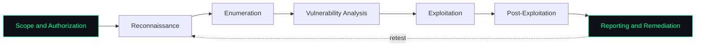

<!-- Replace every YOUR_USERNAME with your GitHub username. The repo must be named YOUR_USERNAME/YOUR_USERNAME -->

<div align="center">


<a href="https://github.com/YOUR_USERNAME">
  
</a>

<br/><br/>

<a href="https://www.linkedin.com/in/marcus-rocha-213911346/"></a>
<a href="mailto:marcusviniciuscarias@gmail.com"></a>


<br/><br/>


</div>

---

## Profile

Software Engineering student in Brazil, specializing in **ethical hacking and cyber defense**. After more than two years in IT support and infrastructure (servers, networks, hardware), I approach security from the system administrator's side: I know how environments are built and maintained, which is where most of them break.

My goal is to understand attacks well enough to detect and prevent them, and to write software that does not introduce the same weaknesses.

**Academic path**
- Técnico em Desenvolvimento de Sistemas
- Bacharelado em Engenharia de Software
- Cyber defense self-study and hands-on lab practice

---

## Security Focus

<div align="center">

| Domain | What I work on |
|:--|:--|
| **Penetration testing methodology** | Reconnaissance, enumeration, vulnerability analysis, exploitation in labs, post-exploitation, reporting |
| **Active Directory security** | Authentication, Kerberos and NTLM concepts, group policy, privilege boundaries, common misconfigurations |
| **Linux security** | Hardening, privilege management, services and permissions, log analysis, privilege escalation concepts |
| **Windows and PowerShell** | Administration and automation, enumeration scripts, event log analysis |
| **Web application security** | OWASP Top 10, injection, broken access control, authentication and session flaws |
| **Network security** | TCP/IP, DNS, DHCP, segmentation, firewall rules, traffic analysis |
| **Secure development** | Input validation, least privilege, safe API design, threat modeling |

</div>

---

## Methodology

<div align="center">



</div>

A finding that is not documented and explained does not help anyone. I treat clear reporting and remediation advice as part of the job, not an afterthought.

---

## Technical Stack

<div align="center">

**Languages and scripting**


**Systems and infrastructure**


**Data and tooling**


</div>

---

## Lab and Learning Path

Everything below is practiced only in environments I own or have explicit permission to test: home labs, virtual machines, and legal training platforms.

- Building a home lab with an Active Directory domain, Linux targets and an isolated attacker machine
- Capture the flag practice to sharpen enumeration and privilege escalation skills
- Web application security with intentionally vulnerable applications
- Writing PowerShell and Python tooling to automate enumeration and log analysis
- Studying detection: reading logs and understanding what an attack looks like from the defender's side

<!-- Add here: certifications, platform profiles (Hack The Box, TryHackMe), writeups -->

---

## Code of Conduct

```text
1. Written authorization before any test.
2. Stay inside the agreed scope.
3. Minimize impact. Never destroy or exfiltrate real data.
4. Document findings clearly and reproducibly.
5. Disclose vulnerabilities responsibly.
```

---

## GitHub Activity

<div align="center">


</div>

---

## Contact

Open to internships, junior positions, study groups and CTF teams in cybersecurity and software engineering.

<div align="center">

[](https://www.linkedin.com/in/marcus-rocha-213911346/)
[](mailto:marcusviniciuscarias@gmail.com)


</div>

<!--
SNAKE SETUP (optional): create .github/workflows/snake.yml in this repo:

name: Generate Snake
on:
  schedule: [{ cron: "0 0 * * *" }]
  workflow_dispatch:
  push: { branches: [main] }
permissions:
  contents: write
jobs:
  generate:
    runs-on: ubuntu-latest
    steps:
      - uses: Platane/snk/svg-only@v3
        with:
          github_user_name: ${{ github.repository_owner }}
          outputs: |
            dist/github-contribution-grid-snake-dark.svg?palette=github-dark
      - uses: crazy-max/ghaction-github-pages@v3.1.0
        with:
          target_branch: output
          build_dir: dist
        env:
          GITHUB_TOKEN: ${{ secrets.GITHUB_TOKEN }}
-->
