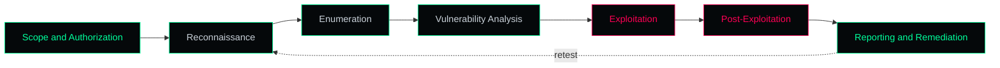

<div align="center">



<a href="https://github.com/">
  
</a>

<br/><br/>



</div>

---

## Profile

Software Engineering student in Brazil, focused on **ethical hacking and cyber defense**. After more than two years in IT support and infrastructure (servers, networks, hardware), I approach security from the administrator's side: I know how environments are built and maintained, which is exactly where most of them break.

The goal is simple: understand attacks well enough to detect them, prevent them, and write software that does not introduce the same weaknesses.

```text
        .-""""""-.
      .'          '.          > status ........ learning
     /   O      O   \         > mode .......... lab only
    :           `    :        > scope ......... authorized
    |                |        > ethics ........ non-negotiable
    :    .------.    :
     \  '        '  /
      '.          .'
        '-......-'
```

---

## Security Focus

<div align="center">

| Domain | What I work on |
|:--|:--|
| **Penetration testing** | Reconnaissance, enumeration, vulnerability analysis, exploitation in labs, post-exploitation, reporting |
| **Active Directory** | Authentication, Kerberos and NTLM concepts, group policy, privilege boundaries, common misconfigurations |
| **Linux security** | Hardening, privilege management, services and permissions, log analysis, privilege escalation concepts |
| **Windows and PowerShell** | Administration, automation, enumeration scripts, event log analysis |
| **Web application security** | OWASP Top 10, injection, broken access control, authentication and session flaws |
| **Network security** | TCP/IP, DNS, DHCP, segmentation, firewall rules, traffic analysis |
| **Secure development** | Input validation, least privilege, safe API design, threat modeling |

</div>

---

## Methodology

<div align="center">



</div>

A finding that is not documented and explained helps nobody. Clear reporting and remediation advice are part of the job.

---

## Technical Stack

<div align="center">

**Operating systems**


**Languages and scripting**


**Data and tooling**


</div>

---

## Lab and Learning Path

Everything below is practiced only in environments I own or have explicit permission to test: home labs, virtual machines and legal training platforms.

- Home lab with an Active Directory domain, Linux targets and an isolated attacker machine (Kali and Parrot)
- Capture the flag practice to sharpen enumeration and privilege escalation skills
- Web application security with intentionally vulnerable applications
- PowerShell and Python tooling to automate enumeration and log analysis
- Detection engineering basics: reading logs and recognizing an attack from the defender's side

<!-- Add here: certifications, platform profiles (Hack The Box, TryHackMe), writeups -->

---

## Code of Conduct

```text
1. Written authorization before any test.
2. Stay inside the agreed scope.
3. Minimize impact. Never destroy or exfiltrate real data.
4. Document findings clearly and reproducibly.
5. Disclose vulnerabilities responsibly.
```

<div align="center">

<br/>


</div>
